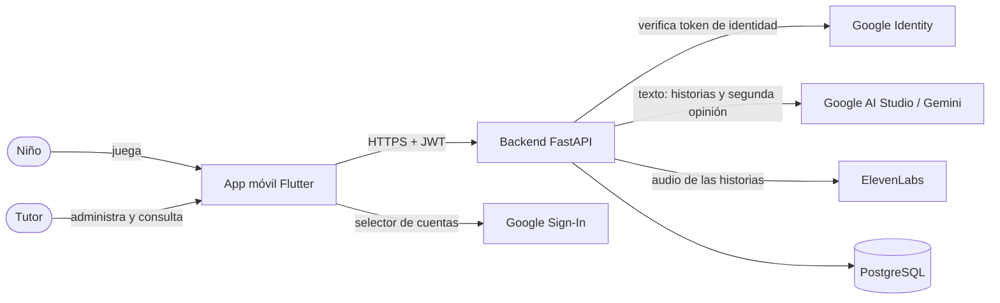
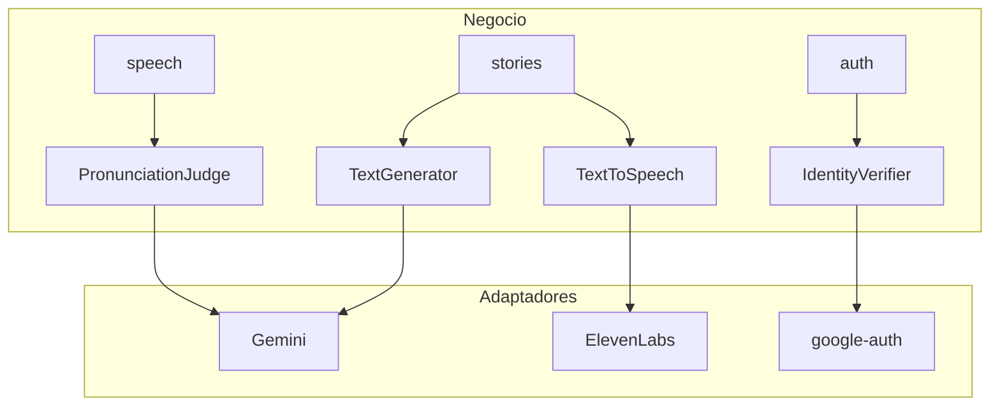
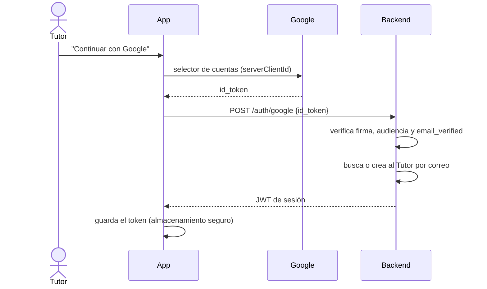
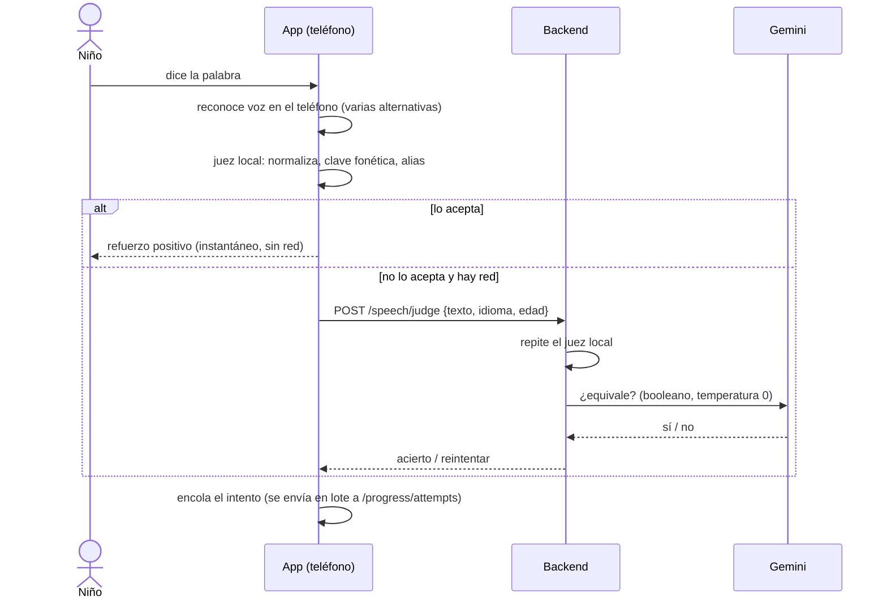
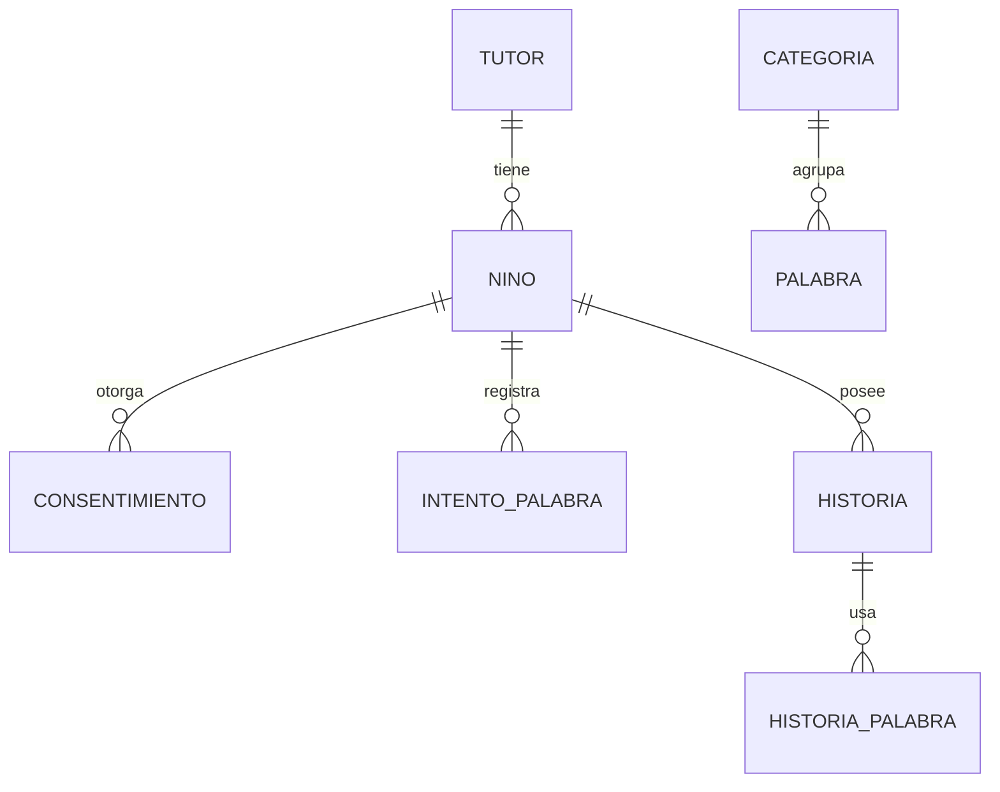
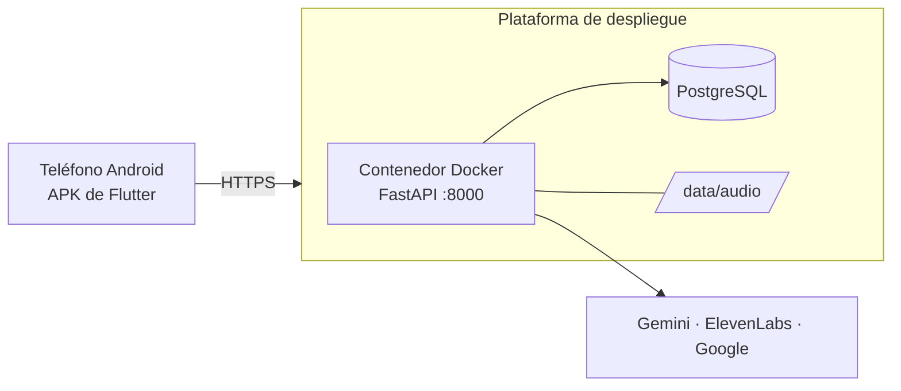

# Documento de Arquitectura de Software (SAD) — English-for-Kids

> **Para qué sirve este documento:** reúne en un solo lugar la arquitectura del sistema tal como está construida hoy: qué piezas tiene, cómo se conectan, dónde se ejecutan y por qué se eligió así. Los *qué* están en `requisitos.md`, las razones detalladas en `decisiones.md` (ADR) y el contrato de la API en `openapi.json`. Este documento los conecta.

Versión: 1.0 · Estado: alineado con el código del repositorio (backend con 102 pruebas automáticas pasando).

---

## 1. Introducción

### 1.1 Propósito
Describir la arquitectura de **English-for-Kids**, una aplicación móvil para que niños de 3 a 6 años (hispanohablantes) aprendan vocabulario en inglés jugando, con ayuda de un adulto (tutor) que gestiona los perfiles y consulta el progreso.

### 1.2 Alcance del producto
| Función | Descripción breve |
|---|---|
| Vocabulario | Imágenes y audio en inglés y español, **sin conexión** |
| Hablar | El niño repite la palabra; el sistema la reconoce con tolerancia a su forma de hablar |
| Historias | Cuentos cortos generados con IA a partir de las palabras elegidas, con narración en voz |
| Progreso | Panel para el tutor: dominio de palabras, racha y días activos |
| Zona del tutor | Sesión con cuenta de Google, perfiles de niños, consentimiento de voz y borrado de datos |

Fuera del alcance de la v1: canales de TV infantil (ADR-006).

### 1.3 Definiciones
| Término | Significado |
|---|---|
| Tutor | Adulto (padre, madre, docente) que tiene la cuenta |
| Niño / perfil | Usuario que juega; no tiene cuenta propia, pertenece a un tutor |
| Juez | Componente que decide si lo que dijo el niño cuenta como acierto |
| Proveedor | Servicio externo detrás de una interfaz (Gemini, ElevenLabs, Google) |
| ADR | *Architecture Decision Record*: registro de una decisión y su razón |

---

## 2. Factores que condicionan la arquitectura

### 2.1 Objetivos de calidad (ordenados por importancia)
1. **Privacidad y seguridad de menores.** Es el factor dominante: condiciona dónde viven las llaves, qué datos se guardan y quién puede ver qué.
2. **Funcionar sin internet para lo esencial.** Un niño debe poder estudiar vocabulario sin conexión.
3. **Tolerancia al habla infantil.** Un reconocimiento estricto frustraría al niño; el juez debe ser indulgente según la edad.
4. **Cambiabilidad de proveedores.** Los servicios de IA y voz cambian de precio y calidad con frecuencia.
5. **Simplicidad de operación.** Un equipo estudiantil debe poder desplegarlo y mantenerlo.

### 2.2 Restricciones
| Tipo | Restricción |
|---|---|
| Plataforma móvil | Flutter, Android primero (RNF-01) |
| Despliegue | Contenedor Docker en la plataforma Dokploy de la universidad (`panel.iscoutb.dev`); respaldo temporal en Render |
| Base de datos | PostgreSQL (ADR-007) |
| IA y voz | Google AI Studio (Gemini) y ElevenLabs; sus llaves nunca viajan en la app |
| Equipo y tiempo | Proyecto académico con equipo pequeño y entrega con fecha |
| Datos de menores | Consentimiento del tutor antes de usar el micrófono; no se guarda el audio de la voz |

---

## 3. Contexto del sistema

**Idea central:** la app solo habla con *nuestro* backend. El backend es el único que conoce las llaves de Gemini y ElevenLabs.

---

## 4. Estilo arquitectónico

**Monolito modular** (ADR-001): una app móvil y un único backend. Cada responsabilidad es un módulo con interfaz clara, pero todo se despliega como un solo contenedor.

*¿Por qué no microservicios?* Con un equipo pequeño y una sola unidad de despliegue, los microservicios añadirían red, orquestación y puntos de fallo sin beneficio real. El monolito modular conserva la separación (se podría extraer un módulo después) con una fracción del costo operativo.

**Principios aplicados**
1. **Offline primero** para lo esencial (ADR-002).
2. **Llaves solo en el servidor** (ADR-003).
3. **Proveedores detrás de interfaces** (ADR-004).
4. **Seguridad y privacidad por defecto.**
5. **El cliente decide lo barato y rápido; el servidor lo caro y secreto.** El juez local corre en el teléfono; Gemini solo se consulta cuando las reglas no bastan.

---

## 5. Vista lógica (componentes)

### 5.1 App móvil (Flutter)
Organizada **por funcionalidad**, no por tipo de archivo, con controladores `ChangeNotifier` y un único cliente HTTP (`ApiClient`) que añade el token y traduce los errores.

| Módulo (`lib/features/…`) | Responsabilidad |
|---|---|
| `auth` | Inicio de sesión con Google, sesión guardada en almacenamiento seguro |
| `children`, `consent` | Perfiles de niños, permiso de voz, pantalla del niño con camino de lecciones |
| `vocabulary` | Categorías, palabras, imágenes y audio locales (`assets/`) |
| `study` | Sesión de estudio: reconocimiento de voz del teléfono, juez local, cola de intentos |
| `stories` | Crear, listar y leer cuentos con su narración |
| `progress` | Panel del tutor (resumen, racha, palabras por reforzar, borrar progreso) |
| `core` | Cliente HTTP, configuración, tema, puerta para adultos |

### 5.2 Backend (FastAPI)

| Módulo (`app/modules/…`) | Responsabilidad | Endpoints principales |
|---|---|---|
| `auth` | Sesión del tutor; verifica el token de Google y emite el JWT propio | `POST /auth/google`, `GET /auth/me` |
| `family` | Perfiles de niños, consentimientos, borrado | `/children`, `/consents` |
| `speech` | Segunda opinión de IA sobre lo que dijo el niño | `POST /speech/judge` (+ `/speech/check` de respaldo) |
| `stories` | Generar cuento, narrarlo, guardarlo | `/stories`, `/stories/{id}/audio` |
| `progress` | Guardar intentos y calcular el resumen | `/progress/attempts`, `/progress/{id}/summary` |
| `providers` | Interfaces y adaptadores externos | — |

**Regla de dependencias:** los módulos de negocio usan las *interfaces* de `providers`, nunca un proveedor concreto.

Cambiar de ElevenLabs a otra voz implica escribir un adaptador nuevo; los módulos de negocio no se tocan. Las pruebas usan proveedores falsos (*fakes*), por eso corren sin llaves y sin red.

---

## 6. Vista de procesos (flujos clave)

### 6.1 Inicio de sesión con Google (RF-09)

El backend **nunca** confía en el correo que diga la app: solo en el token firmado por Google. Un token inválido da 401 y un correo sin verificar da 403.

### 6.2 Repetir una palabra (RF-02, RF-03, RF-04) — ADR-009

Puntos de diseño: el **audio no sale del teléfono** (solo texto); funciona sin conexión con las reglas locales; si la segunda opinión tarda más de ~3 s, se trata como "intenta otra vez"; el feedback es siempre local y positivo (sin porcentajes).

### 6.3 Crear una historia (RF-06, RF-07)
1. El tutor o el niño elige palabras (estudiadas o escritas).
2. `stories` arma un prompt restrictivo para niños y llama a `TextGenerator` (Gemini).
3. Filtra el resultado y valida el idioma pedido (inglés o español).
4. Convierte el texto en audio con `TextToSpeech` (ElevenLabs, una voz por idioma) y guarda texto y audio.
5. La app muestra la historia y reproduce la narración con la petición autenticada.

### 6.4 Progreso (RF-04, RF-05) — ADR-010
La app envía intentos por palabra en lotes de hasta 50, con reintento si falla. El resumen **se calcula al consultarlo** a partir de los intentos guardados, en la zona horaria del tutor. Una palabra se considera dominada con 3 aciertos sin ayuda en inglés; se sugiere reforzar con 3 o más intentos y menos del 40 % de acierto sin ayuda.

---

## 7. Vista de datos

- **Regla de propiedad:** cada petición verifica que el niño pertenezca al tutor de la sesión (RNF-02). Un tutor nunca ve datos de otro.
- **No se guarda el audio de la voz** del niño; solo el resultado de cada intento.
- **Borrado:** el tutor puede borrar el progreso o el perfil completo (derecho a eliminar los datos).
- El esquema se crea al arrancar; las columnas nuevas se añaden con una actualización ligera (`upgrade_schema`). **Pendiente:** migraciones con Alembic.

---

## 8. Vista de despliegue

| Aspecto | Detalle |
|---|---|
| Empaquetado | `src/backend/Dockerfile`, Python 3.12, usuario sin privilegios, puerto 8000 |
| Configuración | Variables de entorno (`DATABASE_URL`, `SECRET_KEY`, `GOOGLE_API_KEY`, `ELEVENLABS_API_KEY`, …); `.env.example` documenta los nombres y `.env` no se versiona |
| Producción prevista | Dokploy en `panel.iscoutb.dev` |
| Respaldo | Render (contenedor + PostgreSQL), usando el mismo Dockerfile y sin cambios de código |
| App | APK de Android; la URL de la API se fija al compilar con `--dart-define=API_BASE_URL=…` |
| Google Sign-In | Cliente OAuth *Web* (audiencia del token) y cliente *Android* (paquete + huella SHA-1 de cada máquina de compilación) |

Como el mismo contenedor corre en cualquier plataforma, cambiar de servidor solo exige cambiar variables y la URL de la app.

---

## 9. Seguridad y privacidad

| Amenaza / riesgo | Mitigación |
|---|---|
| Robo de llaves de IA | Solo existen en el backend; la app no contiene ninguna |
| Suplantación de tutor | Identidad verificada con token firmado por Google (firma, audiencia, correo verificado); sesión con JWT |
| Acceso a datos ajenos | Comprobación de propiedad en cada endpoint sobre un niño |
| Menores y voz | Consentimiento del tutor antes de usar el micrófono; el audio no se almacena ni sale del teléfono |
| Niño entra a la zona del tutor | Pregunta de suma antes de acciones destructivas (borrar progreso o perfil) |
| Contenido inapropiado de la IA | Prompts restrictivos, filtro posterior, vocabulario controlado |
| Inyección en prompts | Entrada sanitizada y respuesta booleana con temperatura 0 en la segunda opinión |
| Acceso con solo nombre y correo | Desactivado por defecto (`ENABLE_BASIC_LOGIN`); solo para pruebas |

---

## 10. Atributos de calidad y escenarios

| Atributo | Escenario | Cómo lo cubre la arquitectura |
|---|---|---|
| Disponibilidad offline | Sin internet, el niño toca una imagen | Audio e imágenes en `assets/`; sin llamada de red (RF-01, RNF-07) |
| Tolerancia | Un niño de 3 años dice "dug" por "dog" | Juez local con clave fonética y alias; indulgencia por edad |
| Cambiabilidad | Cambiar de proveedor de voz | Nuevo adaptador de `TextToSpeech`; módulos de negocio intactos |
| Resiliencia | La IA tarda o falla | Tiempo máximo, mensaje amable y reintento; el vocabulario sigue funcionando |
| Portabilidad | El servidor de la universidad falla | Mismo contenedor desplegado en otra plataforma |
| Mantenibilidad | Añadir una función | Un módulo nuevo por funcionalidad en app y backend |
| Verificabilidad | Probar sin gastar llaves | Proveedores falsos; 102 pruebas automáticas en el backend |

---

## 11. Decisiones arquitectónicas (resumen)

| ADR | Decisión | Razón principal |
|---|---|---|
| 001 | Monolito modular | Equipo pequeño; menor costo operativo |
| 002 | Vocabulario empaquetado en la app | Funciona sin internet y responde al instante |
| 003 | Backend como único intermediario de las APIs | Proteger las llaves |
| 004 | Proveedores detrás de interfaces | Poder cambiarlos sin reescribir |
| 005 | Docker en la plataforma universitaria | Despliegue reproducible |
| 006 | TV infantil aplazada | Fuera del alcance de la v1 |
| 007 | PostgreSQL | Base de datos de la plataforma |
| 008 | Inicio de sesión con Google | Identidad verificada sin gestionar contraseñas |
| 009 | Voz en el teléfono + juez local + Gemini como segunda opinión | Tolerancia, bajo costo y privacidad |
| 010 | Progreso calculado al consultar | Reglas cambiables sin migrar datos |

---

## 12. Riesgos y deuda técnica

| Riesgo | Efecto | Plan |
|---|---|---|
| Disco lleno o caída de la plataforma de despliegue | La API no se puede desplegar | Respaldo en Render con el mismo contenedor |
| Audios de historias en disco efímero | Se pierden al redesplegar | Volumen persistente o almacenamiento de objetos |
| Servidor sin HTTPS propio | Tráfico sin cifrar fuera de pruebas | Dominio con HTTPS para usuarios reales |
| Cuota de ElevenLabs | Historias largas consumen caracteres | Caché y límite de uso por usuario |
| Datos enviados a Gemini en plan gratuito | Condiciones de uso de datos | Enviar solo texto y revisar términos antes de producción |
| Sin migraciones formales | Cambios de esquema delicados | Adoptar Alembic |
| Cola de intentos en memoria | Se pierde si se cierra la app sin conexión | Persistirla localmente |
| Un cliente Android por SHA-1 | Cada máquina de compilación debe registrarse | Documentar el paso; usar una llave de firma compartida |

---

## 13. Trazabilidad requisito → componente

| Requisito | Componente principal |
|---|---|
| RF-01 | `vocabulary` (app) |
| RF-02, RF-03 | `study` (app) y `speech` (backend) + juez |
| RF-04, RF-05 | `progress` (app y backend) |
| RF-06, RF-07 | `stories` (app y backend) + `TextGenerator`, `TextToSpeech` |
| RF-09 | `auth` (backend), `auth` (app) y `IdentityVerifier` |
| RNF-01 | Flutter |
| RNF-02, RNF-04 | `auth`, `family`, `consent` |
| RNF-03 | `providers` |
| RNF-05, RNF-06 | `stories` y configuración del backend |
| RNF-07 | `vocabulary` (assets locales) |
| RNF-08 | Docker y despliegue |

---

## 14. Referencias
- `docs/requisitos.md` — requisitos funcionales y no funcionales.
- `docs/decisiones.md` — registro completo de decisiones (ADR-001 a ADR-010).
- `docs/arquitectura.md` — descripción previa de la arquitectura, ahora resumida aquí.
- `docs/openapi.json` — contrato de la API.
- `README.md` — cómo ejecutar el proyecto.
